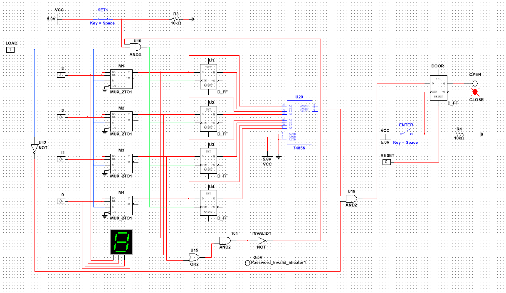
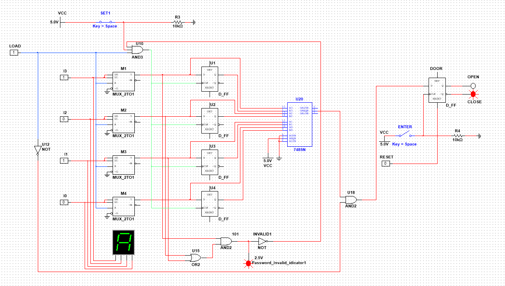
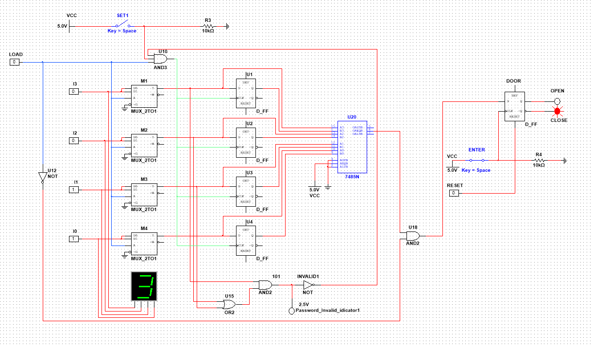
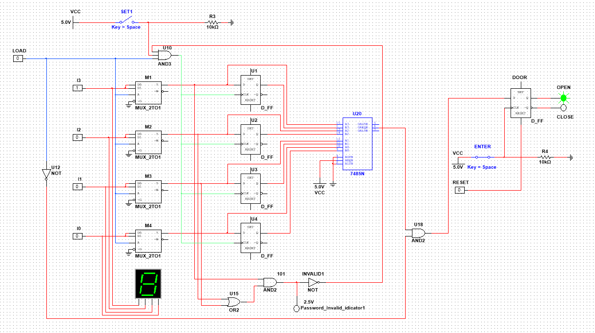
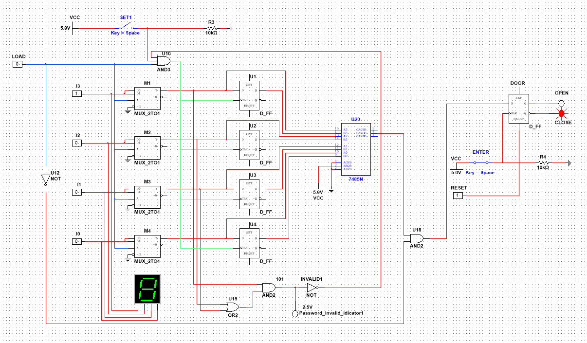
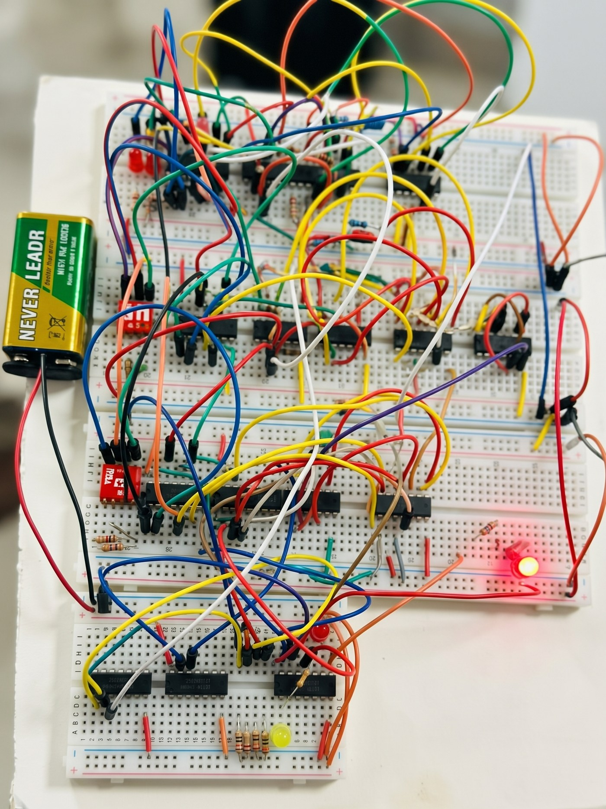

# 3-Digit Digital Password Lock

A digital password lock made only with basic digital logic ICs (**no microcontroller**), designed and simulated in **NI Multisim** and then built on a breadboard.
A 3-digit password is stored in D flip-flops, the entered digits are compared with it, and the door opens (green LED) only when every digit matches.
Digits above 9 are blocked by a BCD validation circuit.

Digital Logic and Circuits (DLC) project, EEE course, AIUB.

**Semester:** Fall 2025-2026 (Digital Logic and Circuits)

## Features

- Each digit is entered as 4-bit **BCD** with switches (3 digits = 12 bits).
- **Set password mode** (`LOAD = 1`): the digits are stored in D flip-flops.
- **Unlock mode** (`LOAD = 0`): the entered digits are compared with the stored password.
- **BCD validation:** 10–15 are not valid digits, so they are rejected and the *Invalid* indicator turns on.
- **ENTER** button checks the password, **RESET** button closes the door again.
- Door status: **Green LED = open**, **Red LED = closed**.
- 7-segment display shows the digit being entered.

## Components Used

- D flip-flops – store the password bits
- 2×1 multiplexers – switch between set-password mode and unlock mode
- 7485 4-bit magnitude comparator – checks if the input equals the stored digit (A = B)
- AND, OR and NOT gates – combine the results and detect invalid BCD digits
- Push buttons (SET, ENTER, RESET), switches, LEDs, resistors and a 7-segment display
- Breadboards, jumper wires and a 9V battery for the hardware version

## How It Works

1. **Set the password:** turn `LOAD` on, put a digit on the 4 switches and press **SET**. The MUX sends the switch values to the D flip-flops and they store the digit.
2. **Validation:** an AND / OR / NOT circuit detects 1010–1111 (10–15). For these values the flip-flop clock is blocked, so an invalid digit can never be saved, and the *Invalid* indicator turns on.
3. **Enter a code:** turn `LOAD` off and put the digits on the switches. The 7485 comparator gives **A = B** for each digit that matches.
4. **Open the door:** the outputs of all digits are joined with AND gates. When everything matches and **ENTER** is pressed, the door flip-flop turns on the **green LED**.
5. **Close the door:** **RESET** clears the door flip-flop and the **red LED** turns on again.

## Project Structure

```
DLC-3-Digit-Digital-Password-Lock/
├── Multisim_Files/
│   ├── 01_1-bit_Password_Lock.ms14                # step 1: one bit
│   ├── 02_4-bit_Password_Lock.ms14                # step 2: one 4-bit digit
│   ├── 03_BCD_0-9_Password_Basic.ms14             # step 3: one BCD digit (0–9)
│   ├── 04_BCD_0-9_Password_Validated.ms14         # step 4: BCD digit with invalid-digit check
│   ├── 05_3-digit_Password_Lock_Simulation.ms14   # final 3-digit lock (simulation)
│   └── 06_3-digit_Password_Lock_Hardware.ms14     # final 3-digit lock (hardware wiring version)
├── Documentation/
│   └── DLC_Project_Report.pdf
└── Screenshots/
```

## Requirements

- **Windows**
- **NI Multisim 14** or newer (the files are `.ms14`) – download from [ni.com/multisim](https://www.ni.com/en/support/downloads/software-products/download.multisim.html)

## Clone the Project

```bash
git clone https://github.com/munshi-rishad/DLC-3-Digit-Digital-Password-Lock.git
```

## Setup and Run

1. Install **NI Multisim** and open it.
2. Click **File → Open** and open `Multisim_Files/05_3-digit_Password_Lock_Simulation.ms14`.
3. Press **Run** (green ▶ button or **F5**) to start the simulation.
4. Set `LOAD` to 1, choose a digit with the input switches and press **SET** to save the password.
5. Set `LOAD` to 0, enter the digits and press **ENTER**. The green LED turns on only if the password is correct.
6. Use **RESET** to close the door.

> To see how the circuit was built step by step, open the files `01` to `04` in order.
> `06_3-digit_Password_Lock_Hardware.ms14` is the version that was wired on the breadboard.

## Project Report

[DLC_Project_Report.pdf](Documentation/DLC_Project_Report.pdf)

## Screenshots

### 1. Set Password

LOAD = 1 and the input 8 (1000) is saved as the password. The door stays closed.

<p align="center">
  
</p>

### 2. Invalid Digit Rejected

LOAD = 1 and the input 10 (1010) is not a BCD digit. The Invalid indicator turns on and the password is not saved.

<p align="center">
  
</p>

### 3. Wrong Password

LOAD = 0, the input 3 does not match the stored 8. After ENTER the red LED stays on.

<p align="center">
  
</p>

### 4. Correct Password

LOAD = 0, the input 8 matches the stored 8. After ENTER the green LED turns on and the door opens.

<p align="center">
  
</p>

### 5. Reset

RESET is pressed, so the door closes again even with the correct input.

<p align="center">
  
</p>

### 6. Hardware Breadboard Setup

The circuit built on breadboards with logic ICs, switches and LEDs.

<p align="center">
  
</p>
